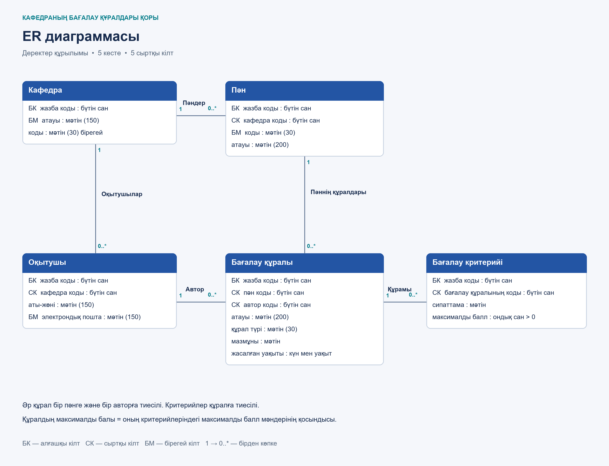
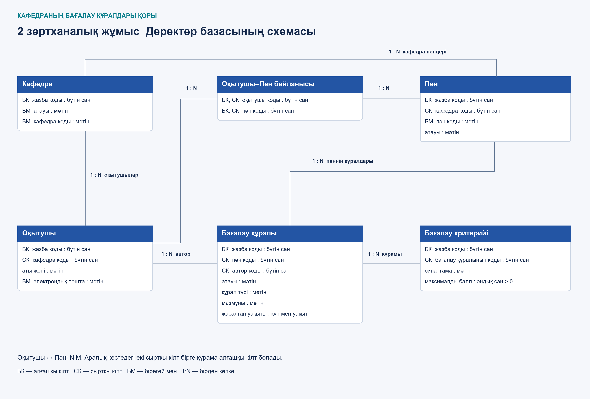

# Ақпараттық жүйе: Кафедраның бағалау құралдары қоры

**Курс:** Ақпараттық жүйелердің қолданбалы бағдарламалық қамтылымы (2026 ж.)

**Автор:** ИС-24А тобының студенті — Какеше Акерке

## 1. Пәндік облыстың сипаттамасы

Жүйе кафедра оқытушыларының бағалау материалдарын бірыңғай қорда сақтайды.
Оқытушы пән мен автор бойынша тест, емтихан және зертханалық тапсырмаларды табады.
Интерфейс материалды қосуға, өзгертуге және жоюға мүмкіндік береді.
Әр материалға бағалау критерийлері бекітіледі, жалпы балл олардың қосындысынан есептеледі.
Іздеу және пән, автор, құрал түрі, балл бойынша сүзгілеу автоматтандырылған.

## 2. Деректер архитектурасы (ER-диаграмма)

ЛР №1 концептуалдық схемасы:



ORM іске асырылған алты кестенің толық схемасы:



- `department` — кафедралар; оқытушылармен және пәндермен 1:N.
- `teacher` — оқытушылар; автор ретінде бағалау құралдарымен 1:N.
- `discipline` — пәндер; бағалау құралдарымен 1:N.
- `assessmenttool` — бағалау материалдары; критерийлермен 1:N.
- `criterion` — критерий сипаттамасы және оң максималды балл.
- `teacherdisciplinelink` — оқытушы мен пәннің N:M байланысы; екі сыртқы кілттен құралған құрама алғашқы кілт.

Құрал жойылғанда оның критерийлері де жойылады. Құралдың жалпы балы жеке сақталмайды, есептеледі.
[Өңделетін ER схемасы](docs/er_diagram_lab2.drawio),
[кластар диаграммасы](docs/class_diagram.png), [тізбектік диаграмма](docs/sequence_diagram.png).

## 3. Технологиялық стек

- **Backend:** Python 3.11+, FastAPI, Uvicorn.
- **Database / ORM:** SQLite, SQLModel, SQLAlchemy.
- **Frontend UI:** Streamlit, Requests.
- **Тестілеу:** pytest, HTTPX, FastAPI TestClient; нақты HTTP және Streamlit AppTest сценарийлері.
- **Инфрақұрылым:** Docker, Docker Compose, Git, GitHub.
- **AI құралдары:** VS Code + GitHub Copilot Chat және Codex; құрылым, тест сценарийлері және код шолуы үшін пайдаланылды.

```text
app/
  main.py                      FastAPI, lifespan, роутерлер
  schemas.py                   Create / Read / Update валидациясы
  container_start.py           Docker базасын алғашқы рет толтыру
  database/
    db.py                      engine, init_db, get_session
    models.py                  ORM кестелері мен байланыстар
  routers/
    assessment_tools.py        CRUD және сүзгілеу
    reference_data.py          пәндер мен оқытушылар анықтамалығы
  frontend/
    api.py                     Requests HTTP клиенті
    ui.py                      Streamlit веб-интерфейсі
tests/
  test_api.py                  pytest + TestClient API тесттері
  test_http_ui.py              нақты HTTP және интерфейс тесттері
  test_container_start.py      алғашқы толтыру және қайта іске қосу
docs/                          диаграммалар, AI промпттары, нұсқаулықтар
Dockerfile                     backend образы
Dockerfile.frontend            frontend образы
docker-compose.yml             екі сервис, желі, volume, healthcheck
.dockerignore                  Docker контекстінің ерекшеліктері
.gitignore                     venv, база, кэш Git-ке жіберілмейді
requirements.txt               барлық жергілікті тәуелділіктер
requirements.backend.txt       сервер тәуелділіктері
requirements.frontend.txt      интерфейс тәуелділіктері
requirements.test.txt          pytest және httpx
pytest.ini                     тесттерді табу баптаулары
seed.py                        қайталанбайтын бастапқы деректер
verify.py                      БД шектеулерін тексеру
README.md                      негізгі құжаттама
```

## 4. Жергілікті іске қосу нұсқаулығы

### Алдын ала талаптар

Docker Desktop (Docker Compose қоса) орнатылып, іске қосылуы керек.
Windows-та WSL 2 және Virtual Machine Platform қажет. Контейнерлер үшін компьютерге
Python не SQLite жеке орнатылмайды. Алғашқы жинауға интернет керек.

### Іске қосу

```bash
git clone https://github.com/kakeseakerke02-oss/applied-is-project-2026-department.git
cd applied-is-project-2026-department
docker compose up --build
```

- **Веб-интерфейс:** http://localhost:8501
- **Swagger UI:** http://localhost:8000/docs
- **Сервер күйі:** http://localhost:8000/

Compose желісінде Streamlit `http://backend:8000` адресіне сұраныс жібереді:
`backend` — сервис атауы. Браузердегі `localhost` — пайдаланушы компьютері.
Frontend backend healthcheck сәтті болған соң іске қосылады.

Алғашқы іске қосуда жеке Docker базасына 3 кафедра, 3 оқытушы, 3 пән,
5 құрал, 5 критерий және 5 оқытушы–пән байланысы енгізіледі.
Компьютердегі бұрынғы `database.db` контейнерге көшірілмейді.
База `department_data` volume ішінде сақталады; қайта іске қосу жойылған жазбаларды қалпына келтірмейді.

Басқа терминалда контейнерлер күйін тексеру:

```bash
docker compose ps
docker compose logs --tail=30
```

Қайта іске қосу (жазбалар сақталады):

```bash
docker compose down
docker compose up --build
```

`docker compose down -v` деректер volume-ын да жояды — кәдімгі қайта іске қосуда `-v` қолданбаңыз.
8000 және 8501 порттарын бұрынғы жергілікті Python процестері қолданса, сол терминалдарда Ctrl+C басыңыз.

### Docker-сіз әзірлеу (Windows PowerShell)

```powershell
python -m venv venv
.\venv\Scripts\python.exe -m pip install -r requirements.txt
.\venv\Scripts\python.exe seed.py
.\venv\Scripts\python.exe -m uvicorn app.main:app --port 8000
```

Бөлек терминалда:

```powershell
$env:BACKEND_URL="http://127.0.0.1:8000"
.\venv\Scripts\python.exe -m streamlit run app/frontend/ui.py
```

## 5. Тесттерді іске қосу

Python 3.11+ орнатылған жергілікті виртуалды ортада:

```powershell
.\venv\Scripts\python.exe -m pip install -r requirements.txt
.\venv\Scripts\python.exe -m pytest -v
```

Белсенді виртуалды ортада дәл сол команда: `pytest -v`.
Тек ЛР №7 TestClient тесттерін орындау: `python -m pytest tests/test_api.py -v`.
pytest барлық `tests/` модульдерін, соның ішінде бұрынғы unittest тесттерін де орындайды.
Docker не қолмен іске қосылған API тесттерге қажет емес.

Әр TestClient тесті уақытша SQLite базасын бастапқы деректермен толтырады.
`Depends(get_session)` тест сессиясымен алмастырылады, lifespan негізгі базаны ашпайды.
Нақты HTTP/UI тесттері бөлек уақытша сервер мен базаны қолданады.
Жеке және Docker базаларындағы пайдаланушы жазбалары өзгермейді.

Тексерілетін сценарийлер: GET тізімі; POST 201 және кейінгі GET;
422 валидациясы; жоқ авторға 404; қайталанатын құралға 409 және rollback;
PATCH кезінде өзге өрістердің сақталуы; DELETE және каскад;
жоқ ID-ге 404; іздеу, балл сүзгісі және SQL-инъекция тәрізді мәтін;
интерфейс арқылы CRUD; қайта іске қосқанда деректердің сақталуы.

## 6. Қорғау және код шолуы

[Код шолуы және шектеулер](docs/lab7_review.md). [Бұрынғы зертханалар нұсқаулығы](docs/labs1-6.md).

Қорғауда:

1. `docker compose down`, кейін `docker compose up --build` орындаңыз.
2. Сайтта іздеу, қосу, өзгерту және растаумен жою әрекеттерін көрсетіңіз.
3. Swagger-де GET, POST, 422 және жоқ ID үшін 404 жауаптарын көрсетіңіз.
4. `pytest -v` нәтижесін және `git log --oneline` тарихын көрсетіңіз.

Қысқа жауаптар:

- **Модель мен кесте:** SQLModel класы — Python сипаттамасы, SQLite кестесі — дискідегі жазбалар.
- **Depends:** сұраныс үшін сессия ашады, жауаптан кейін жабады.
- **PATCH:** тек клиент берген өрістерді жаңартады; POST жаңа жазба жасайды.
- **404:** ID ізделеді; табылмаса HTTPException қайтарылады.
- **Деректер жолы:** Streamlit формасы → Requests → FastAPI → Session → SQLite; жауап кері қайтады.
- **Тест оқшаулауы:** тесттер уақытша базаға жазады, негізгі базаға тимейді.
- **Docker желісі:** backend сервисінің DNS атауы контейнерлер арасында қолданылады; localhost әр контейнердің өзін білдіреді.
- **Volume:** контейнер өшірілсе де база сақталады.

Коммит тарихы нақты орындалған кезеңдерді көрсетеді; мерзімдер қолдан өзгертілмейді.
